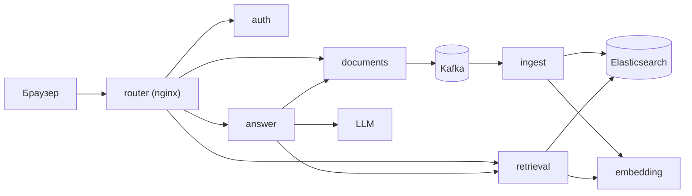

# Микросервисная версия

`apps/backend/` — единственная реализация демо: те же сценарии, разложенные
на сервисы на Go, Java и Python, которые поднимаются локально через
`docker-compose.yml`.

Как читать эту страницу: здесь — почему границы проведены именно так. Запуск —
[../environments/local-development.md](../environments/local-development.md), контракт —
[../reference/api.md](../reference/api.md).

## Принцип деления

Режем по осям масштабирования и владения данными, а не по слоям. «Сервис на
каждый слой» дал бы по копии правил доступа в `retrieval` и `answer`, и они бы
разъехались.

| Сервис      | Язык               | Владеет                          | Профиль нагрузки                                     |
| ----------- | ------------------ | -------------------------------- | ---------------------------------------------------- |
| `auth`      | Java / Spring Boot | `auth_users`                     | редкие записи, дорогой `scrypt`, высокая цена ошибки |
| `documents` | Java / Spring Boot | `documents`, `document_versions` | CPU: PDFBox, POI; пишет события в Kafka              |
| `retrieval` | Go, stdlib         | индекс Elasticsearch             | I/O с жёсткими таймаутами, много коротких запросов   |
| `answer`    | Python / FastAPI   | ничего (stateless)               | сеть: LLM до 90 с, промпты                           |
| `embedding` | Python / FastAPI   | ничего                           | CPU: ONNX, батчинг                                   |
| `ingest`    | Python             | индекс (запись)                  | batch: Kafka -> фрагменты -> эмбеддинги -> bulk      |

### Почему Java там, где Java

`auth` и `documents` — это места, где зрелые библиотеки дешевле своего кода:
Spring Security Crypto для `scrypt`, Flyway для миграций, Micrometer для
метрик, PDFBox и POI для разбора документов. Взамен JVM даёт предсказуемую
работу с памятью и нормальный thread pool для CPU-задач, которые нельзя держать
в event loop Python.

На JVM **не** стоит переносить RAG: работа с промптами и моделями живёт в
Python-экосистеме, и переписывание там стоит дороже, чем экономит.

### Почему Go там, где Go

`retrieval` — чистая I/O-логика: два запроса в Elasticsearch, RRF, короткий
ответ. Здесь важны предсказуемый p99, маленький RSS и отсутствие лишних
зависимостей. Сервис собран на одной стандартной библиотеке (включая проверку
JWT по JWKS), поэтому собирается без сети и не тянет транзитивных пакетов.

### Почему Python там, где Python

`answer`, `embedding`, `ingest` — это модели, промпты и парсинг текста.
Отдельный процесс `embedding` нужен именно затем, чтобы CPU-инференс не делил
GIL и event loop с обработкой HTTP.

## Потоки

**Синхронно:** вопрос идёт `answer -> retrieval -> LLM`. Поиск и генерация
масштабируются независимо: поиск дешёвый и частый, генерация дорогая и редкая.

**Асинхронно:** загрузка документа отвечает сразу после коммита в Postgres.
Событие `document.upserted` уходит в Kafka, `ingest` разбирает текст на
фрагменты, считает векторы и пишет в индекс. Разбор файла и эмбеддинги не
участвуют в HTTP-запросе — это и есть основное отличие от монолита, где загрузка
PDF блокировала event loop.

## Права доступа

Роль превращается в набор аудиторий в одном месте — в `auth`, при выпуске
токена:

| Роль       | `scp`                   |
| ---------- | ----------------------- |
| `user`     | `["public"]`            |
| `employee` | `["public","employee"]` |

`retrieval` не выводит права из `role`: он фильтрует Elasticsearch по `scp` из
подписанного токена. Второго источника истины нет: права считаются ровно один
раз — в `auth` при выпуске токена, — иначе в распределённой системе они
неизбежно разъедутся.

Подпись RS256, публичный ключ — `/.well-known/jwks.json`. Каждый сервис
проверяет токен сам по кэшированному JWKS и не ходит в `auth` на каждый запрос.

## Что осознанно не сделано

- **Не перенесены три возможности прежнего монолита:** запись документа через
  диалог (`kb_upsert` как инструмент модели), прототипный классификатор по
  эмбеддингам и трейсы LangSmith. Сейчас есть загрузка файлом, лексический guard
  и метрики.
- Нет outbox: публикация в Kafka идёт после коммита в Postgres, событие может
  потеряться при падении между шагами. Компенсация — идемпотентный
  `POST /internal/documents`, которым документ можно «дожать».
- Нет DLQ: `ingest` коммитит offset после обработки и пишет ошибку в лог.
- Проверка JWT продублирована в трёх языках (~50 строк). Общую библиотеку
  между языками не делаем: одинаковое поведение держат conformance-векторы
  (`contracts/`), а общий модуль появляется внутри языка, когда потребителей
  становится два. Подробнее — [extensibility.md](extensibility.md).
- Нет NetworkPolicy: `/internal/*` защищены только тем, что входной router их не
  маршрутизирует (и общим токеном `X-Internal-Token`).

Полный список и обоснования — в корневом `README.md`.
